# Video Style Gallery

**English** | [Tiếng Việt](README.vi.md)

   

<p align="center">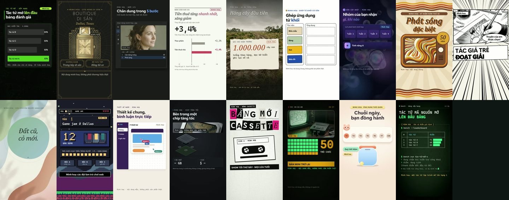</p>
<p align="center">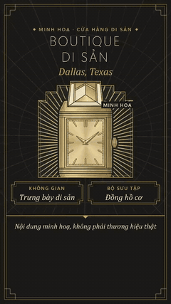 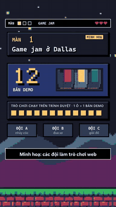 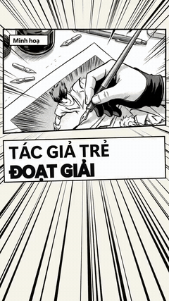</p>

▶ **[Browse all 70 styles in the Gallery](https://tominhphong.github.io/video-style-gallery/)** · 🌐 **[tominhphong.com/video-styles](https://tominhphong.com/video-styles)**

## What this is

A browsable library of the 70 [AgentKit motion-video](https://agentkit.best/?ref=JGRILPGH) styles. Each style has a one-line look, the topics it fits best (scored by Jev), and, for the styles built so far, two 10-second 1080x1920 samples plus a **recipe document** you can copy into your own agent (Claude Code, Codex or similar) so it builds the same look.

It is not a video generator. Every sample is drawn by code (HTML + GSAP, rendered with HyperFrames); the recipes describe layout, palette, type, scene types, pacing, caption rules and the traps hit while building.

## How it works

```
topic list (176)  ->  Jev scores each style x topic  ->  top 3 topics per style
        ->  one full build + two 10 s samples per style  ->  recipe document  ->  gallery
```

1. 176 candidate news and explainer topics were written across real estate, government, AI, culture, games, finance, science, lifestyle and community.
2. Jev (TypeSafe) scored every style against every topic: "is this a strong fit for a 45-60 s explainer on this topic?"
3. Each style's best topic became one full 1080x1920 build; the next two became 10-second samples.
4. The build is written up as the style's recipe document.

## What's new

- **2026-11-13** 22 of 70 styles built (waves 1-3, wave 3 demo-only, silent 12 s). Samples and recipe documents for all 22.
- **2026-11-11** Gallery page, topic list and Jev scores published.

## Use

| Say to your agent | What happens |
|---|---|
| "Build a 55 s vertical explainer in the `retro-crt-broadcast` style about this story." | The agent reads the recipe from `docs/retro-crt-broadcast.md` and follows its layout, palette and scene rules |
| "Pick a style for a product-launch story." | Use the fit scores in the Gallery: each card lists its top 3 topics |
| "Copy the recipe for `soft-clay-3d`." | The Gallery's **Copy recipe** button copies the document |

## Built styles (22 of 70)

| Preview | Style | Family | Best-fit topic | Jev |
|---|---|---|---|---|
| <a href="https://tominhphong.github.io/video-style-gallery/#accelerated-compute">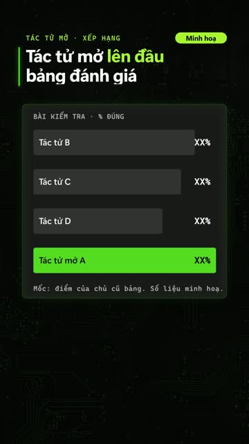</a> | [`accelerated-compute`](docs/accelerated-compute.md) | Brand-inspired | Chip maker unveils a GPU with benchmark charts against last year's model | 0.89 |
| <a href="https://tominhphong.github.io/video-style-gallery/#ambient-intelligence">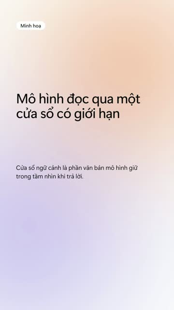</a> | [`ambient-intelligence`](docs/ambient-intelligence.md) | Brand-inspired | How a large language model uses a context window | 0.72 |
| <a href="https://tominhphong.github.io/video-style-gallery/#art-deco-luxury">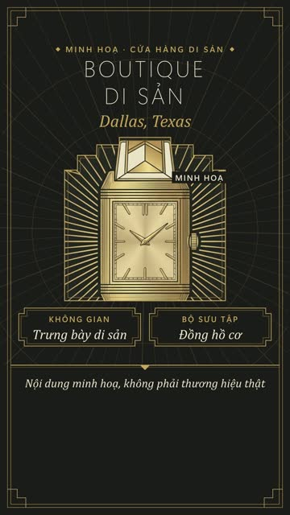</a> | [`art-deco-luxury`](docs/art-deco-luxury.md) | Aesthetic | Perfume house relaunches a 1920s classic fragrance | 0.89 |
| <a href="https://tominhphong.github.io/video-style-gallery/#blueprint-engineering">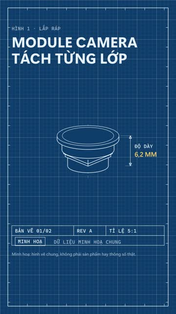</a> | [`blueprint-engineering`](docs/blueprint-engineering.md) | Aesthetic | Smartphone maker shows an exploded view of its new camera module | 0.78 |
| <a href="https://tominhphong.github.io/video-style-gallery/#character-comedy">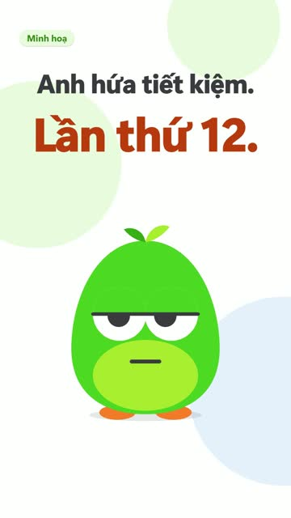</a> | [`character-comedy`](docs/character-comedy.md) | Brand-inspired | Habit-tracking app adds streaks and a mascot to help people save money | 0.83 |
| <a href="https://tominhphong.github.io/video-style-gallery/#cinematic-technology">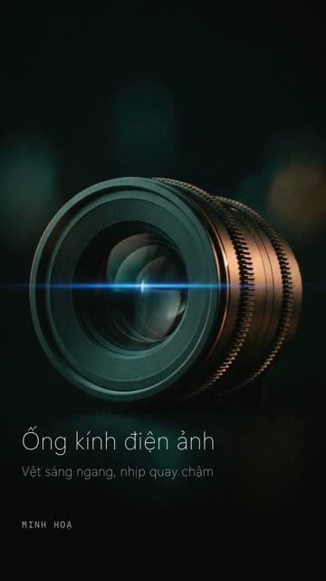</a> | [`cinematic-technology`](docs/cinematic-technology.md) | Brand-inspired | Camera maker launches a cinema lens with anamorphic look | 0.89 |
| <a href="https://tominhphong.github.io/video-style-gallery/#comic-multiverse">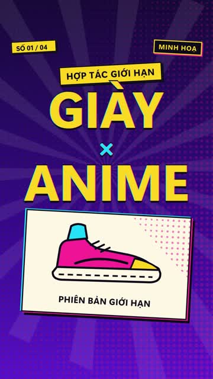</a> | [`comic-multiverse`](docs/comic-multiverse.md) | House | Youth sneaker and streetwear brand announces an anime collaboration | 0.79 |
| <a href="https://tominhphong.github.io/video-style-gallery/#creative-suite">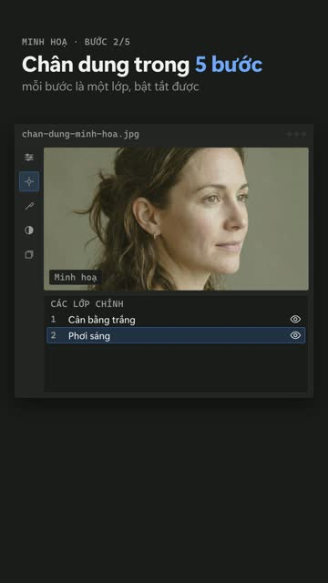</a> | [`creative-suite`](docs/creative-suite.md) | Brand-inspired | Photo editing app releases AI masking and before-and-after tools | 0.86 |
| <a href="https://tominhphong.github.io/video-style-gallery/#data-editorial">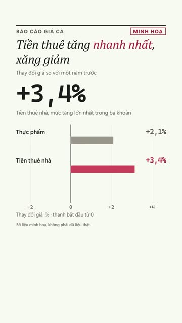</a> | [`data-editorial`](docs/data-editorial.md) | Aesthetic | Monthly housing report: inventory, median price, days on market in Austin | 0.85 |
| <a href="https://tominhphong.github.io/video-style-gallery/#documentary-purpose">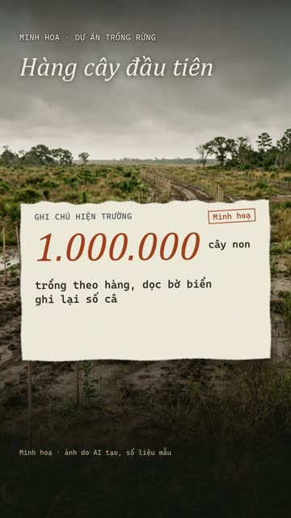</a> | [`documentary-purpose`](docs/documentary-purpose.md) | Brand-inspired | Nature reserve outside Austin restores prairie and tells the founder's story | 0.87 |
| <a href="https://tominhphong.github.io/video-style-gallery/#functional-playful">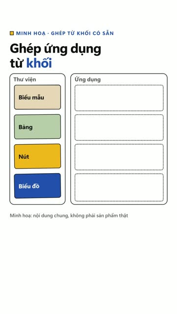</a> | [`functional-playful`](docs/functional-playful.md) | Brand-inspired | How to assemble a flat-pack bookshelf in four steps | 0.88 |
| <a href="https://tominhphong.github.io/video-style-gallery/#glass-keynote">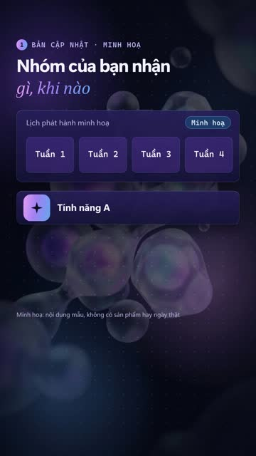</a> | [`glass-keynote`](docs/glass-keynote.md) | House | Phone operating system update personalises colours and widgets | 0.85 |
| <a href="https://tominhphong.github.io/video-style-gallery/#groovy-seventies">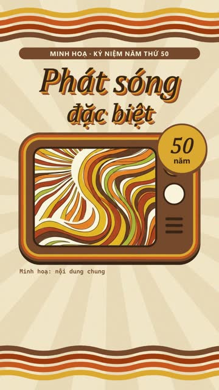</a> | [`groovy-seventies`](docs/groovy-seventies.md) | Aesthetic | Retro seventies diner reopens in Fort Worth with a nostalgic menu | 0.86 |
| <a href="https://tominhphong.github.io/video-style-gallery/#manga-ink">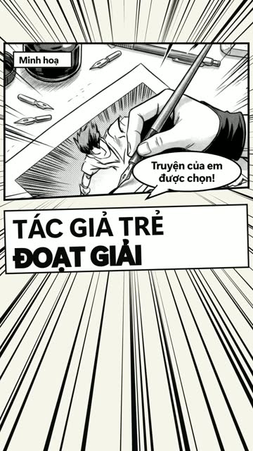</a> | [`manga-ink`](docs/manga-ink.md) | Aesthetic | Youth sneaker and streetwear brand announces an anime collaboration | 0.83 |
| <a href="https://tominhphong.github.io/video-style-gallery/#organic-biomorphic">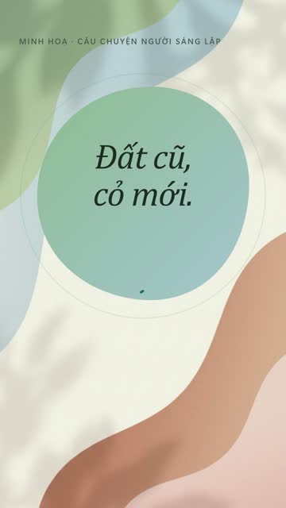</a> | [`organic-biomorphic`](docs/organic-biomorphic.md) | Aesthetic | Wellness app launches a guided breathing programme | 0.88 |
| <a href="https://tominhphong.github.io/video-style-gallery/#pixel-arcade">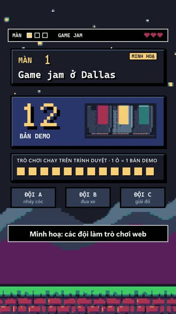</a> | [`pixel-arcade`](docs/pixel-arcade.md) | Aesthetic | Retro console returns as a mini edition with fifty games | 0.76 |
| <a href="https://tominhphong.github.io/video-style-gallery/#playful-productivity">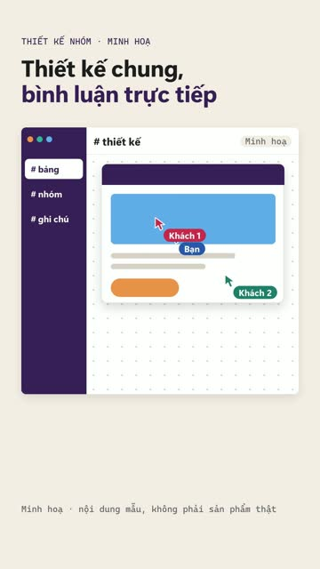</a> | [`playful-productivity`](docs/playful-productivity.md) | Brand-inspired | Team chat app adds threads, emoji reactions and integrations | 0.85 |
| <a href="https://tominhphong.github.io/video-style-gallery/#precision-hardware">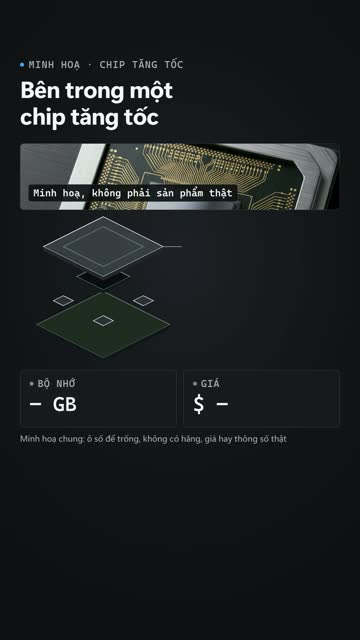</a> | [`precision-hardware`](docs/precision-hardware.md) | Brand-inspired | Smartphone maker shows an exploded view of its new camera module | 0.89 |
| <a href="https://tominhphong.github.io/video-style-gallery/#punk-zine">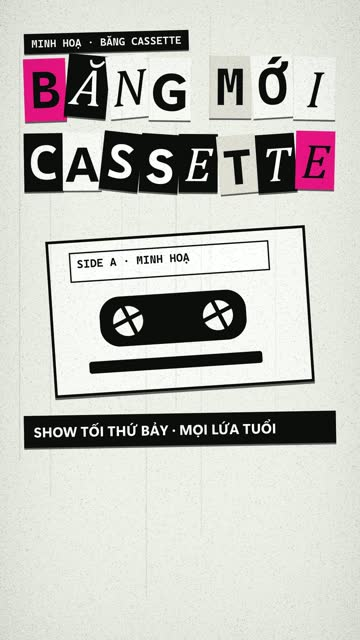</a> | [`punk-zine`](docs/punk-zine.md) | Aesthetic | Underground zine fair in Austin: bands, printers and tickets | 0.82 |
| <a href="https://tominhphong.github.io/video-style-gallery/#retro-crt-broadcast">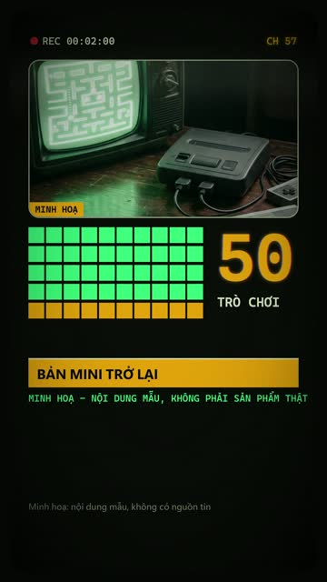</a> | [`retro-crt-broadcast`](docs/retro-crt-broadcast.md) | Aesthetic | Retro TV network marks fifty years with a special broadcast | 0.90 |
| <a href="https://tominhphong.github.io/video-style-gallery/#soft-clay-3d">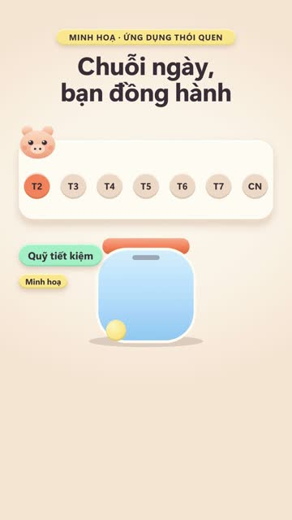</a> | [`soft-clay-3d`](docs/soft-clay-3d.md) | Aesthetic | Toy company releases a build-it-yourself robot kit for kids | 0.85 |
| <a href="https://tominhphong.github.io/video-style-gallery/#terminal-ops">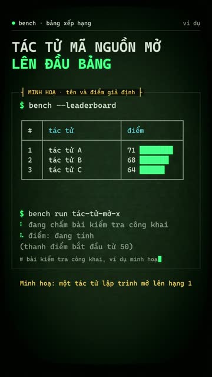</a> | [`terminal-ops`](docs/terminal-ops.md) | Aesthetic | Command line tool that turns a README into a deployment | 0.81 |

**Not built yet (48):** `athletic-impact`, `bauhaus-geometry`, `calm-workspace`, `cinematic-product-launch`, `cinematic-streaming`, `community-chaos`, `constructivist-poster`, `creative-canvas`, `developer-workflow`, `editorial-collage-explainer`, `editorial-intelligence`, `expressive-material`, `extreme-energy`, `fluent-productivity`, `friendly-system-motion`, `gradient-fintech`, `holographic-hud`, `human-storytelling`, `immersive-console`, `ink-woodblock`, `isometric-systems`, `joyful-pop`, `keynote-stage`, `kinetic-typography`, `mid-century-retro`, `minimal-future-product`, `mission-control`, `modular-build`, `monochrome-developer`, `monochrome-luxury`, `music-editorial`, `neo-brutalist-web`, `neon-cyberpunk`, `newsprint-editorial`, `paper-cut-collage`, `playful-game-system`, `precision-dark-product`, `premium-ui-demo`, `product-spec-film`, `quirky-editorial`, `saas-bento`, `sensory-tech`, `sport-editorial`, `swiss-kinetic-editorial`, `systematic-enterprise`, `vaporwave-memphis`, `wpa-screenprint`, `y2k-liquid-chrome`.

## Get AgentKit

The styles come from the AgentKit motion-video skill. **Affiliate disclosure:** the link below is the author's referral link; buying through it gives you 20% off your first purchase (per the AgentKit referral programme) and the author earns a commission. The gallery itself is free and Apache-2.0.

https://agentkit.best/?ref=JGRILPGH

## Notes

- Samples are generic "illustration" content, silent, and labelled as such; they show the look and motion of a style, not a real news story.
- The recipe documents are written from trial builds. Tool names inside them (the `agy` image helper, `motion_tools.py`, VieNeu voice) are private helpers of the author's setup and are not included.
- Fit scores are a guide, not a rule.

## Credits and licence

Created by **Phong To**. Apache-2.0 (see `LICENSE`). Style profiles come from [AgentKit motion-video](https://agentkit.best/?ref=JGRILPGH) (MIT); see `NOTICE` for the upstream source. Page layout inspired by video-shotcraft (Apache-2.0); no code or assets were copied.
