# Thư viện phong cách video

[English](README.md) | **Tiếng Việt**

   

<p align="center">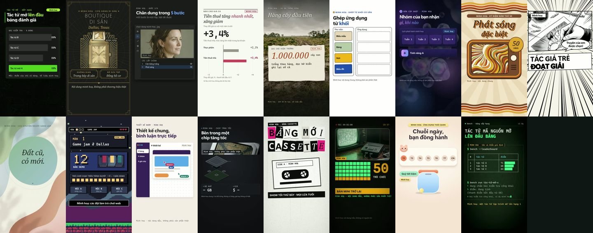</p>
<p align="center">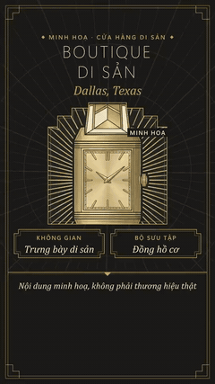 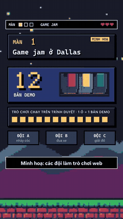 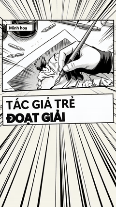</p>

▶ **[Xem cả 70 phong cách trong Thư viện](https://tominhphong.github.io/video-style-gallery/)** · 🌐 **[tominhphong.com/video-styles](https://tominhphong.com/video-styles)**

## Đây là gì

Thư viện 70 phong cách video của [AgentKit motion-video](https://agentkit.best/?ref=JGRILPGH). Mỗi phong cách có mô tả kiểu hình ảnh, các chủ đề hợp nhất (điểm Jev) và, với các phong cách đã dựng, hai đoạn mẫu 10 giây 1080x1920 cùng một **tài liệu công thức** để chép vào agent của bạn (Claude Code, Codex...) dựng lại đúng kiểu đó.

Đây không phải công cụ tạo video. Mọi đoạn mẫu đều vẽ bằng mã (HTML + GSAP, dựng bằng HyperFrames); công thức mô tả bố cục, bảng màu, chữ, các loại cảnh, nhịp, quy tắc phụ đề và các bẫy gặp khi dựng.

## Cách hoạt động

```
danh sách chủ đề (176)  ->  Jev chấm từng phong cách x chủ đề  ->  3 chủ đề tốt nhất mỗi phong cách
        ->  1 video đầy đủ + 2 đoạn mẫu 10 giây mỗi phong cách  ->  tài liệu công thức  ->  thư viện
```

1. Viết 176 chủ đề tin tức và giải thích: bất động sản, chính phủ, AI, văn hóa, game, tài chính, khoa học, đời sống, cộng đồng.
2. Jev (TypeSafe) chấm từng phong cách với từng chủ đề: "phong cách này có hợp mạnh với một video giải thích 45-60 giây về chủ đề này không?"
3. Chủ đề tốt nhất của mỗi phong cách thành một bản dựng đầy đủ 1080x1920; hai chủ đề kế thành đoạn mẫu 10 giây.
4. Bản dựng được viết lại thành tài liệu công thức của phong cách đó.

## Có gì mới

- **13/11/2026** 17 trên 70 phong cách đã dựng (đợt 1-2), có đoạn mẫu và tài liệu công thức.
- **11/11/2026** Đăng trang thư viện, danh sách chủ đề và điểm Jev.

## Cách dùng

| Nói với agent | Điều gì xảy ra |
|---|---|
| "Dựng video dọc 55 giây phong cách `retro-crt-broadcast` về tin này." | Agent đọc công thức ở `docs/retro-crt-broadcast.md` và làm theo bố cục, màu, quy tắc cảnh |
| "Chọn phong cách cho tin ra mắt sản phẩm." | Xem điểm hợp trong Thư viện: mỗi thẻ ghi 3 chủ đề hợp nhất |
| "Chép công thức của `soft-clay-3d`." | Nút **Chép công thức** trong Thư viện chép tài liệu |

## Các phong cách đã dựng (17 trên 70)

| Xem trước | Phong cách | Nhóm | Chủ đề hợp nhất | Jev |
|---|---|---|---|---|
| <a href="https://tominhphong.github.io/video-style-gallery/#accelerated-compute">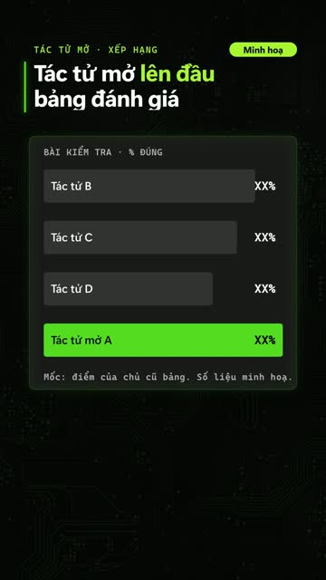</a> | [`accelerated-compute`](docs/accelerated-compute.md) | Lấy cảm hứng thương hiệu | Chip maker unveils a GPU with benchmark charts against last year's model | 0.89 |
| <a href="https://tominhphong.github.io/video-style-gallery/#art-deco-luxury">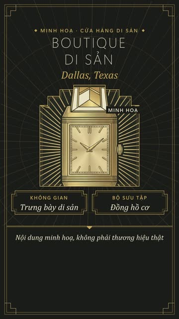</a> | [`art-deco-luxury`](docs/art-deco-luxury.md) | Thẩm mỹ | Perfume house relaunches a 1920s classic fragrance | 0.89 |
| <a href="https://tominhphong.github.io/video-style-gallery/#creative-suite">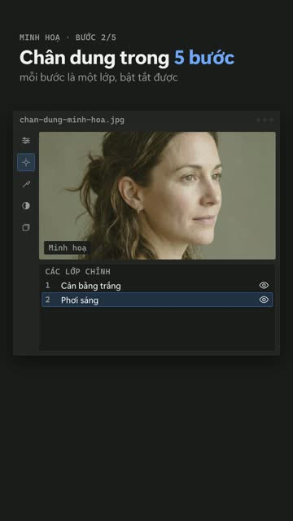</a> | [`creative-suite`](docs/creative-suite.md) | Lấy cảm hứng thương hiệu | Photo editing app releases AI masking and before-and-after tools | 0.86 |
| <a href="https://tominhphong.github.io/video-style-gallery/#data-editorial">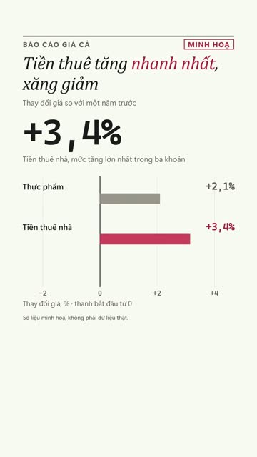</a> | [`data-editorial`](docs/data-editorial.md) | Thẩm mỹ | Monthly housing report: inventory, median price, days on market in Austin | 0.85 |
| <a href="https://tominhphong.github.io/video-style-gallery/#documentary-purpose">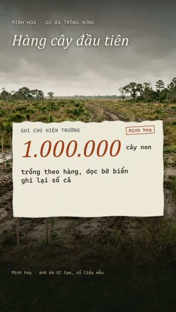</a> | [`documentary-purpose`](docs/documentary-purpose.md) | Lấy cảm hứng thương hiệu | Nature reserve outside Austin restores prairie and tells the founder's story | 0.87 |
| <a href="https://tominhphong.github.io/video-style-gallery/#functional-playful">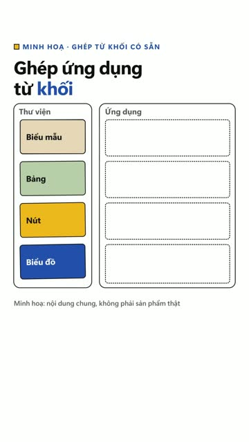</a> | [`functional-playful`](docs/functional-playful.md) | Lấy cảm hứng thương hiệu | How to assemble a flat-pack bookshelf in four steps | 0.88 |
| <a href="https://tominhphong.github.io/video-style-gallery/#glass-keynote">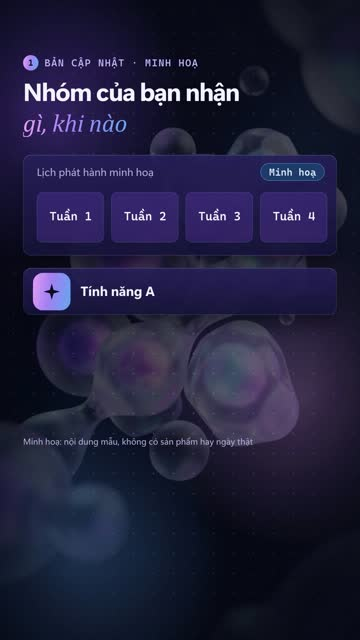</a> | [`glass-keynote`](docs/glass-keynote.md) | Của nhà | Phone operating system update personalises colours and widgets | 0.85 |
| <a href="https://tominhphong.github.io/video-style-gallery/#groovy-seventies">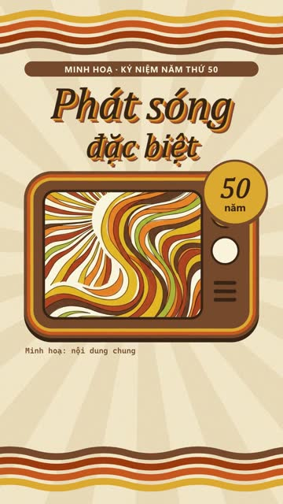</a> | [`groovy-seventies`](docs/groovy-seventies.md) | Thẩm mỹ | Retro seventies diner reopens in Fort Worth with a nostalgic menu | 0.86 |
| <a href="https://tominhphong.github.io/video-style-gallery/#manga-ink">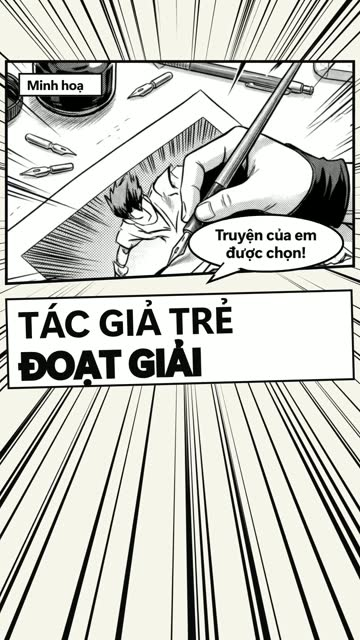</a> | [`manga-ink`](docs/manga-ink.md) | Thẩm mỹ | Youth sneaker and streetwear brand announces an anime collaboration | 0.83 |
| <a href="https://tominhphong.github.io/video-style-gallery/#organic-biomorphic">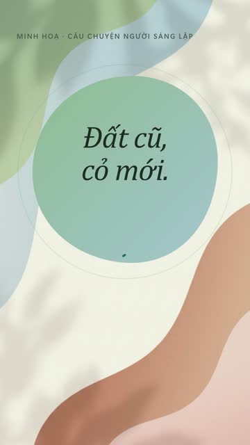</a> | [`organic-biomorphic`](docs/organic-biomorphic.md) | Thẩm mỹ | Wellness app launches a guided breathing programme | 0.88 |
| <a href="https://tominhphong.github.io/video-style-gallery/#pixel-arcade">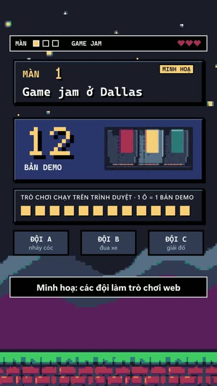</a> | [`pixel-arcade`](docs/pixel-arcade.md) | Thẩm mỹ | Retro console returns as a mini edition with fifty games | 0.76 |
| <a href="https://tominhphong.github.io/video-style-gallery/#playful-productivity">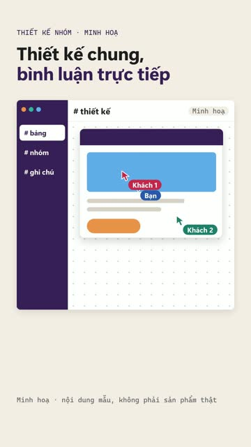</a> | [`playful-productivity`](docs/playful-productivity.md) | Lấy cảm hứng thương hiệu | Team chat app adds threads, emoji reactions and integrations | 0.85 |
| <a href="https://tominhphong.github.io/video-style-gallery/#precision-hardware">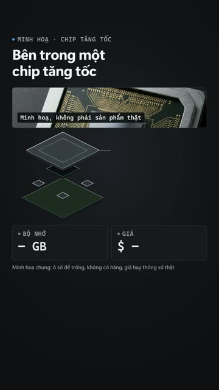</a> | [`precision-hardware`](docs/precision-hardware.md) | Lấy cảm hứng thương hiệu | Smartphone maker shows an exploded view of its new camera module | 0.89 |
| <a href="https://tominhphong.github.io/video-style-gallery/#punk-zine">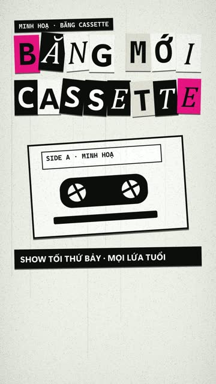</a> | [`punk-zine`](docs/punk-zine.md) | Thẩm mỹ | Underground zine fair in Austin: bands, printers and tickets | 0.82 |
| <a href="https://tominhphong.github.io/video-style-gallery/#retro-crt-broadcast">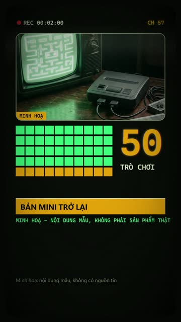</a> | [`retro-crt-broadcast`](docs/retro-crt-broadcast.md) | Thẩm mỹ | Retro TV network marks fifty years with a special broadcast | 0.90 |
| <a href="https://tominhphong.github.io/video-style-gallery/#soft-clay-3d"></a> | [`soft-clay-3d`](docs/soft-clay-3d.md) | Thẩm mỹ | Toy company releases a build-it-yourself robot kit for kids | 0.85 |
| <a href="https://tominhphong.github.io/video-style-gallery/#terminal-ops">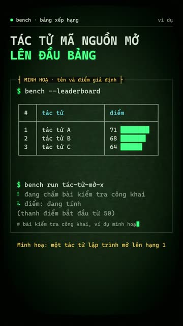</a> | [`terminal-ops`](docs/terminal-ops.md) | Thẩm mỹ | Command line tool that turns a README into a deployment | 0.81 |

**Chưa dựng (53):** `ambient-intelligence`, `athletic-impact`, `bauhaus-geometry`, `blueprint-engineering`, `calm-workspace`, `character-comedy`, `cinematic-product-launch`, `cinematic-streaming`, `cinematic-technology`, `comic-multiverse`, `community-chaos`, `constructivist-poster`, `creative-canvas`, `developer-workflow`, `editorial-collage-explainer`, `editorial-intelligence`, `expressive-material`, `extreme-energy`, `fluent-productivity`, `friendly-system-motion`, `gradient-fintech`, `holographic-hud`, `human-storytelling`, `immersive-console`, `ink-woodblock`, `isometric-systems`, `joyful-pop`, `keynote-stage`, `kinetic-typography`, `mid-century-retro`, `minimal-future-product`, `mission-control`, `modular-build`, `monochrome-developer`, `monochrome-luxury`, `music-editorial`, `neo-brutalist-web`, `neon-cyberpunk`, `newsprint-editorial`, `paper-cut-collage`, `playful-game-system`, `precision-dark-product`, `premium-ui-demo`, `product-spec-film`, `quirky-editorial`, `saas-bento`, `sensory-tech`, `sport-editorial`, `swiss-kinetic-editorial`, `systematic-enterprise`, `vaporwave-memphis`, `wpa-screenprint`, `y2k-liquid-chrome`.

## Lấy AgentKit

Các phong cách lấy từ bộ AgentKit motion-video. **Tiết lộ liên kết tiếp thị:** link dưới đây là link giới thiệu của tác giả; mua qua link được giảm 20% lần mua đầu (theo chương trình giới thiệu của AgentKit) và tác giả nhận hoa hồng. Thư viện này miễn phí, giấy phép Apache-2.0.

https://agentkit.best/?ref=JGRILPGH

## Ghi chú

- Đoạn mẫu là nội dung "minh hoạ" chung, không tiếng, có ghi rõ; chỉ để xem kiểu hình ảnh và chuyển động, không phải tin thật.
- Tài liệu công thức viết từ các bản dựng thử, bằng tiếng Anh. Tên công cụ trong đó (`agy`, `motion_tools.py`, giọng VieNeu) là công cụ riêng của tác giả, không kèm theo.
- Điểm hợp chỉ là gợi ý, không phải luật.

## Ghi công và giấy phép

Tạo bởi **Phong To**. Apache-2.0 (xem `LICENSE`). Phong cách lấy từ [AgentKit motion-video](https://agentkit.best/?ref=JGRILPGH) (MIT); xem `NOTICE` để biết nguồn gốc. Bố cục trang lấy cảm hứng từ video-shotcraft (Apache-2.0); không chép mã hay tài nguyên.
